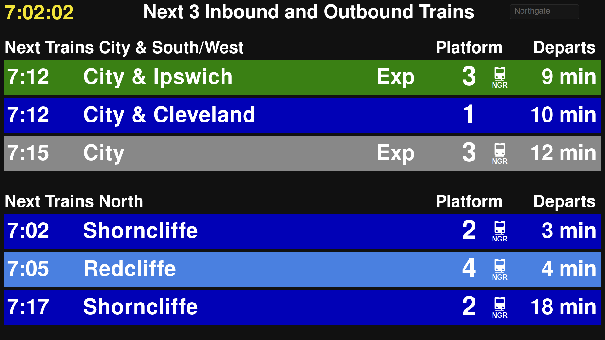

# Queensland Rail station sign

A live departure board for any South East Queensland rail station, built from the TransLink GTFS static and GTFS-realtime feeds. A FastAPI backend serves the sign page (`web/`) and a JSON API (`/api/stations`, `/api/departures`). The default station is Northgate, styled after its real sign.

## Features

- Live departures from the TransLink GTFS-realtime feed (delays, cancellations, skipped stops, platform changes), falling back to the timetable if the feed is unavailable.
- Searchable station picker; the choice is kept in the URL.
- Line colours, express ("Exp") markers and "City & ..." destinations as on the real signs.
- NGR (New Generation Rollingstock) icon on services known to be run by an NGR, based on trainspotter sightings (see [NGR icon](#ngr-icon)).
- Roma Street single list of 6 trains with a scrolling message line.
- A centred "No scheduled services from this platform" message when a station has nothing upcoming.
- Scales to any screen size, so it can be left running full screen on a spare display.

## Examples

Northgate, the default station, shows the next 3 trains to the city and the next 3 to the north, with NGR icons:



Roma Street shows a single list of the next 6 trains, including Gold Coast and Domestic Airport services, with a scrolling message on the last line:


Other stations, such as Ipswich, show trains to the city and trains away from it:


The screenshots were taken with `--infer-ngr` so that the NGR icon shows on most services.

## Setup

```bash
python3 -m venv .venv
source .venv/bin/activate
pip install -r requirements.txt
```

## Start

```bash
python -m backend
```

Then open <http://127.0.0.1:8731/>.

The default port is `8731`. The first run downloads and indexes the static GTFS feed (~35 MB), so startup takes a little longer. The feed is cached in `data/` and refreshed daily.

### Choosing a station

The sign opens on Northgate. Use the search box at the top right of the page: click it and type part of a station name, then pick from the list. The choice is stored in the URL, e.g. `http://127.0.0.1:8731/?station=Ipswich`, so you can bookmark it.

To change the default station, use `--station` (a station name, with or without " station"):

```bash
python -m backend --station "Fortitude Valley"
```

Sections are split into trains heading to the city (inbound) and away from it (outbound). Northgate keeps the titles from its real sign ("City & South/West" and "North"); other stations use "City" and "Outbound". Roma Street shows a single list of the next 6 trains instead, with the 7th line reserved for a message (`CITY_MESSAGE` in `backend/departures.py`).

### Options

| Option | Default | Description |
| --- | --- | --- |
| `--station` | `Northgate` | Station shown when the page opens. |
| `--host` | `127.0.0.1` | Interface to bind to. Use `0.0.0.0` to serve other devices on the network. |
| `--port` | `8731` | Port to listen on. |
| `--show-attribution` | off | Show the TransLink data attribution / licence line at the bottom of the sign. |
| `--infer-ngr` | off | Also guess NGR from the run code (a "D" prefix) where there are no sightings. |

Example:

```bash
python -m backend --host 0.0.0.0 --port 9000 --show-attribution
```

### Running with uvicorn directly

```bash
uvicorn backend.app:app --port 8731
```

This skips the `--station`, `--show-attribution` and `--infer-ngr` options.

## NGR icon

The GTFS feeds do not say what train runs a service, so the NGR icon is based on trainspotter sightings in `backend/stock_sightings.csv`. Each row says "run code X was seen to be stock Y", where the run code is the end of the GTFS trip ID (e.g. `...-44306-D103` is run `D103`).

- Services are assumed to be older stock unless sightings say NGR.
- An exact run code needs 1 sighting; a glob such as `D1*` needs 2. The most specific pattern wins.
- Trips calling at stations NGRs cannot serve (Ferny Grove line, west of Ipswich) are never shown as NGR.
- With `--infer-ngr`, runs with a "D" prefix and no sightings are guessed to be NGR.
- The file is re-read when it changes, so edits apply without restarting.

Manage sightings with `python -m backend.stock`:

```bash
python -m backend.stock add D880 NGR --source "platform photo"
python -m backend.stock add "D1*" IMU --source "platform photo"

# Turn the rows of a real sign photo into sightings (dry run unless --save)
python -m backend.stock sign --station Northgate --date 2026-10-19 --time 17:30 \
  '5:42 1 NGR Cleveland' '5:57 1 - Cleveland' --save

# Compare sightings with the run-code guess and the feed
python -m backend.stock check
```

## Troubleshooting

- `address already in use`: another process is on the port. Check with `ss -ltnp 'sport = :8731'`, or start on a different port with `--port`.
