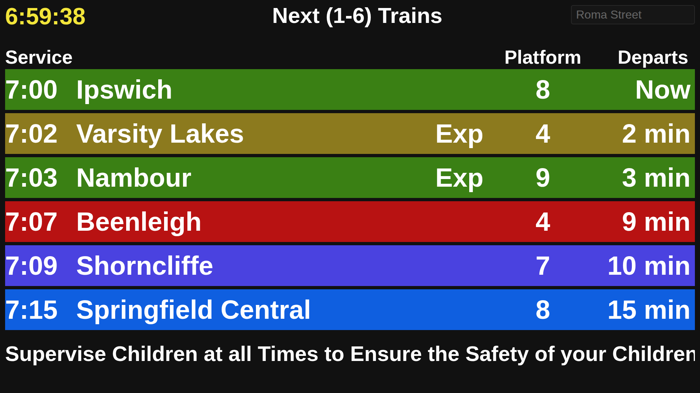
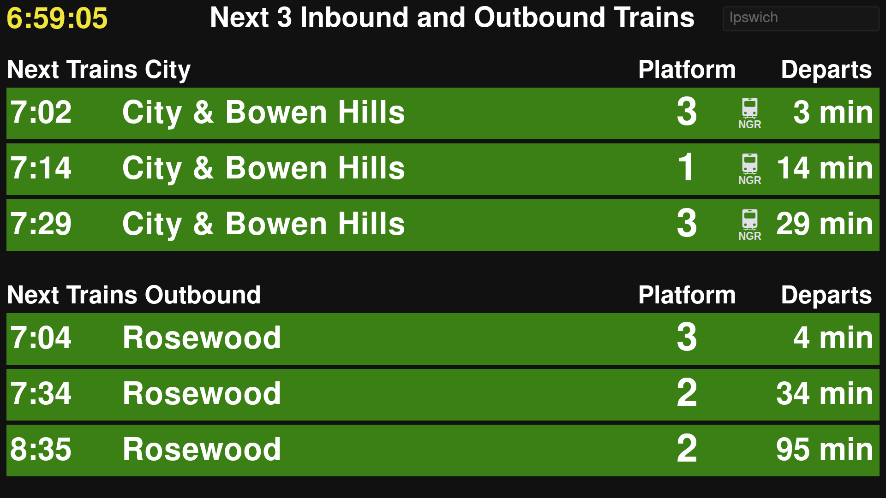
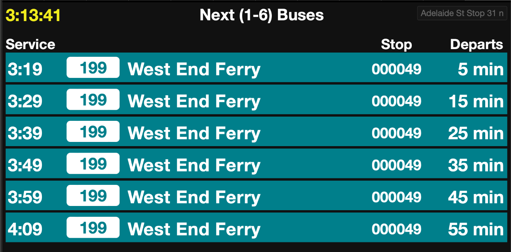

# Queensland rail station and bus stop sign

A live departure board for any South East Queensland rail station or TransLink bus stop, built from the TransLink GTFS static and GTFS-realtime feeds. A FastAPI backend serves the sign page (`web/`) and a JSON API (`/api/stops`, `/api/departures`, and `/api/stations` for trains only). The default station is Northgate, styled after its real sign.

## Examples

Roma Street shows a single list of the next 6 trains, with a scrolling message on the last line:



Other stations, such as Ipswich, show trains to the city and trains away from it:



Bus stops show a single list of the next 6 buses, each with its route number in a white badge, the destination, and the stop code. Every bus row uses one teal colour that no rail line uses.



## Setup

```bash
python3 -m venv .venv
source .venv/bin/activate
pip install -r requirements.txt
```

## Start

```bash
python -m backend
```

Then open <http://127.0.0.1:8731/>.

The default port is `8731`. The first run downloads and indexes the static GTFS feed (~35 MB), so startup takes a little longer. The feed is cached in `data/` (as `index.pkl`) and refreshed daily. Bus stops make the feed several times larger to index than rail alone, so the first run takes noticeably longer than it did for trains only.

### Choosing a station or bus stop

The sign opens on Northgate. Use the search box at the top right of the page: click it and type part of a station or bus stop name, or a bus stop code (the number on the stop's pole), then pick from the list. Each result is tagged **Train** or **Bus**, and bus results show their stop code, which tells apart stops that share a name (for example the two sides of a street). Click the box without typing to list the train stations.

The choice is stored in the URL, so you can bookmark it. `stop` takes a stop id, a bus stop code or a name:

```
http://127.0.0.1:8731/?stop=Ipswich
http://127.0.0.1:8731/?stop=000001
```

The older `?station=Ipswich` form still works.

To change the default, use `--stop` (a station or bus stop name, a bus stop code, or an id). `--station` is the older name for the same option, and `--stop` wins if both are given:

```bash
python -m backend --stop "Fortitude Valley"
python -m backend --stop 001855
```

If a name matches both a station and a bus stop, the station is chosen. Add `--mode bus` (or `--mode train`) to look only among that kind:

```bash
python -m backend --stop "Cultural Centre" --mode bus
```

### Bus stops

Bus stops use the same TransLink feeds as the trains, so no extra data is needed. A standalone stop is shown on its own. A busway station (such as Cultural Centre) shows the buses from all of its bays in one list, with the bay in the Stop column. Buses are listed in departure order, with realtime delays applied where the feed has them; a bus with no realtime entry shows its scheduled time. Buses that end their trip at the stop, and cancelled or skipped calls, are left out. Ferries and trams are not supported.

Sections are split into trains heading to the city (inbound) and away from it (outbound). Northgate keeps the titles from its real sign ("City & South/West" and "North"); other stations use "City" and "Outbound". Roma Street shows a single list of the next 6 trains instead, with the 7th line reserved for a scrolling message. The messages are listed in `backend/city_messages.json` and change every minute.

### Adding your own Roma Street messages

Add your own text to the list in `backend/city_messages.json`; it is a plain JSON array of strings:

```json
[
  "Supervise Children at all Times to Ensure the Safety of your Children",
  "Customers, Please Keep Your Possessions With You at all Times",
  "Your own message here"
]
```

The file is read on every request, so changes show up without restarting the server. The sign rotates through the messages in order, one per minute.

### Options

| Option | Default | Description |
| --- | --- | --- |
| `--stop` | `Northgate` | Station or bus stop shown when the page opens: a name, a bus stop code or an id. |
| `--station` | `Northgate` | Older name for `--stop`; `--stop` wins if both are given. |
| `--mode` | either | `train` or `bus`: only look for the `--stop` among that kind. Without it, a station wins over a bus stop with the same name. |
| `--host` | `127.0.0.1` | Interface to bind to. Use `0.0.0.0` to serve other devices on the network. |
| `--port` | `8731` | Port to listen on. |
| `--show-attribution` | off | Show the TransLink data attribution / licence line at the bottom of the sign. |
| `--no-infer-ngr` | off | Stop guessing the train type from the run code (`D` = NGR icon, `J` = 3 CAR icon). With this, only runs listed in `backend/stock_sightings.csv` show an icon. |

Example:

```bash
python -m backend --host 0.0.0.0 --port 9000 --show-attribution
```

### Running with uvicorn directly

```bash
uvicorn backend.app:app --port 8731
```

This skips the `--stop`, `--station`, `--mode` and `--show-attribution` options.

## Troubleshooting

- `address already in use`: another process is on the port. Check with `ss -ltnp 'sport = :8731'`, or start on a different port with `--port`.
- `Unknown station or stop`: the name did not match anything. The message suggests close matches; a bus stop can also be given by its code. Use `--mode` if the name belongs to both a station and a bus stop.
- A bus shows its scheduled time but never a live one: not every bus is in the realtime feed. The row has no live data until TransLink publishes it.

## API

| Endpoint | Description |
| --- | --- |
| `GET /api/stops?q=&mode=&limit=` | Search stations and bus stops by name, stop code or id. `mode` is `train` or `bus`. With no `q`, lists the train stations. |
| `GET /api/departures?stop=` | The departure board. `stop` is an id, bus stop code or name; `station` is accepted as the older name. Optional `mode` resolves an id used by both kinds. |
| `GET /api/stations` | Train stations only (unchanged, for existing clients). |
